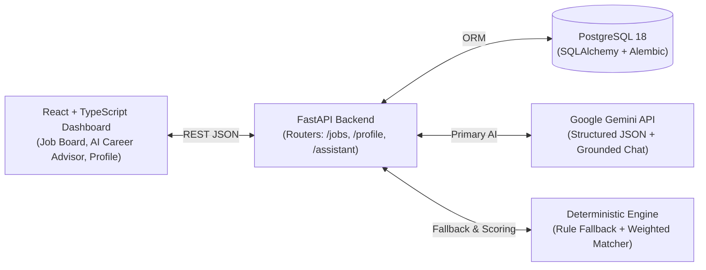

# Job Application Manager — AI-Powered Career & Skill Gap Platform

An end-to-end **Fullstack & AI Engineering** portfolio application that helps job seekers track applications, extract structured requirements from job descriptions using **Google Gemini Structured Outputs**, compute **explainable skill match scores & skill gaps**, and consult a **Context-Grounded AI Career Advisor**.

---

## Key Engineering Highlights

1. **Hybrid AI + Deterministic Architecture**
   - **LLM Structured Extraction (`POST /jobs/{id}/analyze`):** Uses Google Gemini (`responseSchema`) validated against Pydantic models to extract `required_skills`, `preferred_skills`, `experience_level`, and a concise role `summary`.
   - **Deterministic Rule-Based Fallback:** If `GEMINI_API_KEY` is omitted, offline, or rate-limited, the service automatically falls back to a deterministic keyword/section parser so the application and test suite run reliably with zero external cost.
2. **Transparent & Explainable Skill Matching Engine (`GET /jobs/{id}/match`)**
   - Normalizes skill names and common aliases (`ReactJS` ↔ `React`, `Postgres` ↔ `PostgreSQL`, `Py` ↔ `Python`, `ML` ↔ `Machine Learning`).
   - Computes an explainable weighted score instead of a black-box LLM guess:
     $$\text{Score} = 80\% \times \frac{|\text{Matched Required}|}{|\text{Total Required}|} + 20\% \times \frac{|\text{Matched Preferred}|}{|\text{Total Preferred}|}$$
   - Separates skills into **Matched Required**, **Matched Preferred**, **Missing Required (Primary Skill Gap)**, and **Missing Preferred**.
3. **Portfolio-Wide Context-Grounded AI Career Advisor (`POST /assistant/chat`)**
   - Multi-turn career consultation grounded on the candidate's full profile, all tracked job applications, their respective match scores, application statuses, and aggregated market skill gaps.
4. **Production-Minded Backend Foundation**
   - Modular FastAPI routers (`jobs`, `profile`, `assistant`), centralized environment validation via `pydantic-settings`, PostgreSQL 18 + SQLAlchemy 2.x, schema migrations via **Alembic**, and an isolated **Pytest** suite using in-memory SQLite dependency overrides.

---

## System Architecture



---

## Tech Stack

| Layer | Technologies |
|---|---|
| **Frontend** | React 19, Vite, TypeScript, Modern CSS Grid/Flexbox |
| **Backend** | Python 3.11+, FastAPI, Uvicorn, HTTPX |
| **Database & ORM** | PostgreSQL 18, SQLAlchemy 2.x, Alembic Migrations |
| **Validation & Config** | Pydantic v2, `pydantic-settings` |
| **AI / LLM** | Google Gemini API (`generateContent` + `responseSchema`), Rule-Based Fallback |
| **Testing & Linting** | Pytest, FastAPI `TestClient`, Oxlint, TypeScript (`tsc -b`) |

---

## Project Structure

```text
job-application-manager/
├── backend/
│   ├── app/
│   │   ├── routers/
│   │   │   ├── assistant.py      # POST /assistant/chat (Global AI Career Advisor)
│   │   │   ├── jobs.py           # CRUD /jobs, POST /jobs/{id}/analyze, GET /jobs/{id}/match
│   │   │   └── profile.py        # GET & PUT /profile (Candidate profile & skills)
│   │   ├── services/
│   │   │   ├── analyzer.py       # Gemini structured output extractor + rule fallback
│   │   │   ├── assistant.py      # Context-grounded career & interview advisor
│   │   │   └── matcher.py        # Canonical skill normalizer & 80/20 weighted matcher
│   │   ├── config.py             # Validated environment settings (pydantic-settings)
│   │   ├── database.py           # SQLAlchemy engine & session dependency
│   │   ├── main.py               # FastAPI app initialization & CORS middleware
│   │   ├── models.py             # Job & CandidateProfile ORM models
│   │   └── schemas.py            # Pydantic request/response schemas
│   ├── migrations/               # Alembic migration scripts
│   ├── scripts/
│   │   ├── check_db.py           # Database connectivity check utility
│   │   └── seed_jobs.py          # Idempotent sample data seeder (6 tech roles + profile)
│   ├── tests/
│   │   ├── conftest.py           # Isolated in-memory SQLite fixture & get_db override
│   │   ├── test_jobs.py          # CRUD, validation, status filter, & analyzer tests
│   │   └── test_matching.py      # Profile deduplication, matcher, & AI assistant tests
│   ├── .env.example
│   ├── alembic.ini
│   └── requirements.txt
└── frontend/
    ├── src/
    │   ├── api/                  # Modular API client (client.ts, jobs.ts, profile.ts, assistant.ts)
    │   ├── components/           # JobList, JobForm, ProfileCard, CareerAssistant
    │   ├── types/                # TypeScript domain interfaces (job.ts, profile.ts)
    │   ├── utils/                # Client-side transparent skill matcher (matcher.ts)
    │   ├── App.tsx               # Tabbed dashboard shell & KPI summary cards
    │   └── App.css
    └── package.json
```

---

## REST API Endpoints

| Method | Endpoint | Description |
|---|---|---|
| `GET` | `/health` | Health check status (`{"status": "healthy"}`) |
| `GET` | `/profile` | Get candidate profile & skills |
| `PUT` | `/profile` | Update candidate name, headline, and deduplicated skills |
| `GET` | `/jobs` | List jobs (optional `?status_filter=Saved\|Applied\|Interview\|Offer\|Rejected`) |
| `POST` | `/jobs` | Create a new job application entry |
| `GET` | `/jobs/{id}` | Get a specific job by ID |
| `PATCH` | `/jobs/{id}` | Update job details, `application_status`, or `notes` |
| `DELETE` | `/jobs/{id}` | Delete a job entry |
| `POST` | `/jobs/{id}/analyze` | Extract required/preferred skills, level, and summary via Gemini AI |
| `GET` | `/jobs/{id}/match` | Compute weighted match score and skill gaps against candidate profile |
| `POST` | `/jobs/{id}/assistant` | Job-specific interview preparation & skill gap coaching |
| `POST` | `/assistant/chat` | Global multi-turn AI Career Advisor grounded on all jobs & profile |

---

## Getting Started (Local Development)

### 1. Prerequisites
- **Python 3.11+**
- **Node.js 20+**
- **PostgreSQL 16/18** (with a database named `job_application_manager`)
- *(Optional)* Free **Google Gemini API Key** from [Google AI Studio](https://aistudio.google.com/apikey)

### 2. Backend Setup
```powershell
cd backend
python -m venv .venv
.\.venv\Scripts\activate
pip install -r requirements.txt

# Copy environment template and fill in your PostgreSQL password & optional GEMINI_API_KEY
copy .env.example .env

# Run database migrations
python -m alembic upgrade head

# (Optional) Seed sample tech jobs and initial candidate profile
python -m scripts.seed_jobs

# Start the FastAPI server
uvicorn app.main:app --reload --port 8000
```
The API will be available at `http://127.0.0.1:8000` (Swagger UI at `http://127.0.0.1:8000/docs`).

### 3. Frontend Setup
```powershell
cd frontend
npm install
npm run dev
```
Open `http://localhost:5173` in your browser.

---

## Running Tests & Quality Checks

The backend test suite uses an isolated in-memory SQLite database and deterministic AI fallback, so it runs in under a second without touching your PostgreSQL data or consuming API quota:

```powershell
# Backend unit & integration tests (12 tests)
cd backend
.\.venv\Scripts\python.exe -m pytest -v

# Frontend TypeScript type-check, production build, and linter
cd ../frontend
npm run build
npm run lint
```
